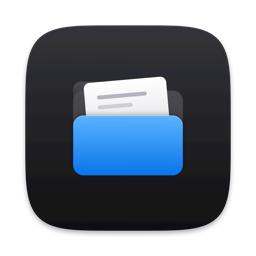
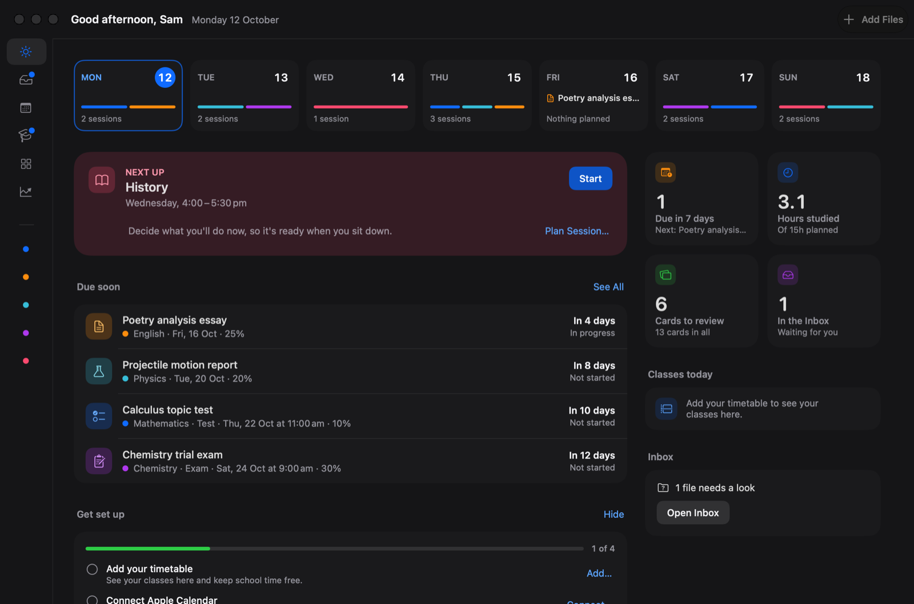
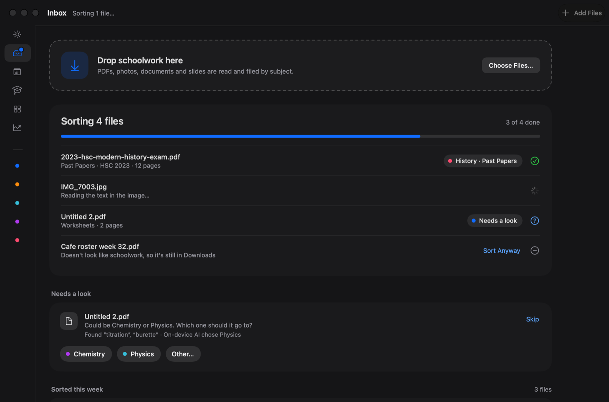
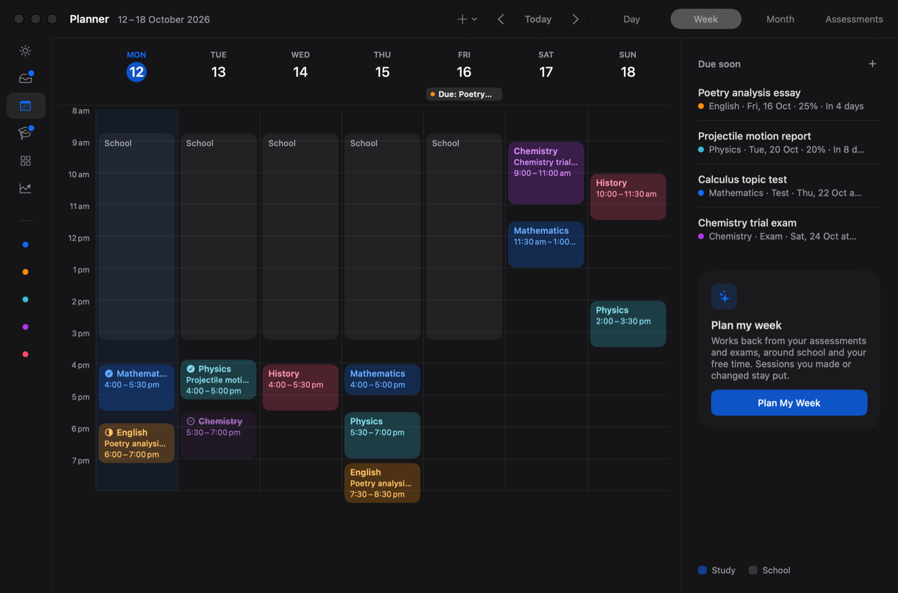
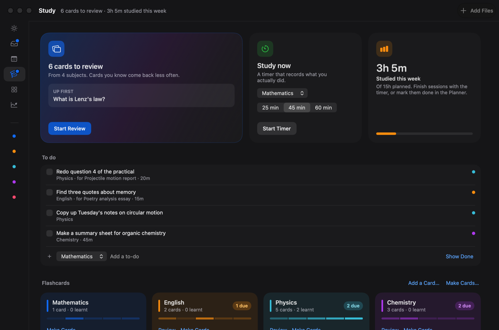
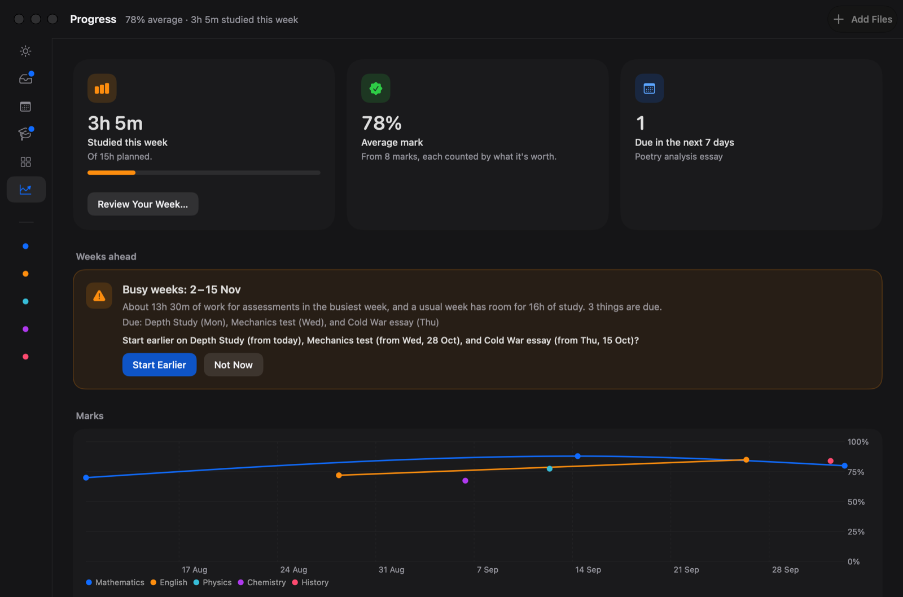

<p align="center">
  
</p>

<h1 align="center">Folio</h1>

<p align="center">
  <b>Your schoolwork, sorted.</b><br>
  A free Mac app for high school and university students.
</p>

<p align="center">
  <a href="https://github.com/Hugh169/folio-study/releases/latest"><b>Download Folio</b></a> ·
  <a href="#install">Install</a> ·
  <a href="#privacy">Privacy</a> ·
  <a href="#for-developers">Build from source</a>
</p>

Drop your files in and Folio files them by subject, then plans your study back
from what's due, helps you study, and shows how you're going. It runs on your
Mac, with no account.



## What it does

- **Sorts your files.** Drop files on Folio, or let it watch your Downloads
  folder. It reads documents, scans, photos, recordings and videos, and files
  each one in the right subject folder: real folders you can open in Finder.
  When it isn't sure, it asks. Every move can be undone, and Folio never
  deletes a file.
- **Knows what's due.** Assessments and exams, with their weighting and your
  marks. Folio spots them in the task sheets you drop in and asks before
  adding them.
- **Plans your week.** Plan My Week works back from due dates and exams,
  around school, your timetable (including Week A and Week B) and your Apple
  Calendar events.
- **Helps you study.** A study timer that records what you did, flashcards
  written from your own notes, search inside your files, and past papers
  paired with their marking guidelines.
- **Shows your progress.** Marks weighted by what each assessment is worth,
  study time against your plan, a weekly review, and a warning before a busy
  week.

Folio comes set up for NSW HSC, VCE, QCE, WACE, SACE, GCSE and A level, the IB
Diploma, US high school and AP, Cambridge International, and university. You
can change every subject, folder and exam board.

## Screenshots

<table>
  <tr>
    <td width="50%"><br><b>Inbox.</b> Files are sorted as they arrive, and Folio asks when it isn't sure.</td>
    <td width="50%"><br><b>Planner.</b> Study planned around school and your events, working back from what's due.</td>
  </tr>
  <tr>
    <td width="50%"><br><b>Study.</b> Flashcards from your own notes, to-dos and a timer that records what you did.</td>
    <td width="50%"><br><b>Progress.</b> Marks, study time and a warning before a busy week.</td>
  </tr>
</table>

## What you need

- A Mac with Apple silicon, running macOS 27 or later.
- Apple Intelligence turned on, for the on-device AI. It helps Folio sort,
  writes flashcards and sums up files. Without it, Folio still sorts files
  using keywords, your class times and what it learns from your choices.
- Optional: Claude, with your own Anthropic API key (see [Privacy](#privacy)).

## Install

Folio is free. It isn't notarized by Apple, so macOS asks you to confirm the
first time you open it.

1. Download `Folio-<version>.dmg` from the
   [latest release](https://github.com/Hugh169/folio-study/releases/latest) and open it.
2. Drag Folio onto the Applications folder in the window that opens.
3. Open Folio from Applications. macOS says it can't check Folio for malicious software. Click
   **Done**.
4. Open **System Settings › Privacy & Security**, scroll down to **Security**,
   and click **Open Anyway** next to the message about Folio. Enter your Mac
   password, then click **Open Anyway** again.

To check that your download is the one published, compare its checksum with
the one on the release page:

```bash
shasum -a 256 ~/Downloads/Folio-<version>.dmg
```

**Updating.** Quit Folio, open the new disk image and drag Folio onto
Applications, choosing **Replace**. Then repeat steps 3 and 4. Your subjects,
files and plans are kept. Because Folio isn't signed by a registered Apple
developer, macOS may ask again for access to Calendar and Reminders, and, if
you use Claude, for your Mac password so Folio can read its key. Choose
**Always Allow**.

## Privacy

- **No account, no tracking.** Folio sends nothing to its developer: no
  analytics, no crash reports, no ads.
- **Your files stay yours.** Folio moves files into ordinary folders on your
  Mac and keeps its own records in its sandbox on your Mac.
- **On-device AI.** Reading, sorting, flashcards, summaries and search run on
  your Mac, using Apple's on-device model.
- **Calendar is read only.** Folio plans around your events and never changes
  them. If you turn on Reminders, Folio adds your assessments to a list called
  Folio there.
- **Claude is optional, and off until you add a key.** You add your own API
  key, which Folio keeps in your Mac's keychain. Folio then sends Claude the
  notes you choose when you ask it to write flashcards, and, if you turn on
  sorting with Claude, the text of files it couldn't sort on its own (photos
  only if you allow it). Anthropic doesn't train its models on this and
  normally deletes it within 30 days. Requests are charged to your Anthropic
  account, so Folio doesn't limit them: flashcards usually cost well under a
  US cent a file, and sorting roughly US 10–20 cents per 1,000 files.
  Anthropic accounts are for adults, so if you're under 18, a parent should
  hold the account and the key.
- **The only connection Folio makes** is to Anthropic's API, and only when
  you use Claude.
- **Delete All Data.** Settings › AI & Privacy › Delete All Data removes
  everything Folio keeps on your Mac, including its Claude key, then quits.
  Your School folder and the files in it stay where they are. To remove Folio
  itself, delete it from your Applications folder.

## Languages

Folio is in English, French, Spanish, German and Chinese (Simplified), and
follows your Mac's language. The translations are in beta: they're drafts that
no native speaker has checked yet. If something reads wrong, please
[suggest a fix](https://github.com/Hugh169/folio-study/issues/new?template=translation.md).

## For developers

### Build

You need Xcode 27 on a Mac with Apple silicon running macOS 27.

1. Open `Folio.xcodeproj`.
2. Choose the **Folio** scheme and press Run.

Builds are signed to run locally, so no Apple developer account is needed.

- `Folio/` is the SwiftUI app.
- `FolioKit/` is a Swift package with everything behind the screens: reading
  files, sorting, the planner and the record store. It also holds the
  `folio-eval` and `folio-testset` tools.
- `Tools/` holds the icon source and scripts for translations, the test set,
  the self-test and releases.

### Test

```bash
cd FolioKit && swift test
```

Sorting accuracy is measured on a set of generated files; see
[Tools/TestSet/README.md](Tools/TestSet/README.md). Never commit real past
papers: `TestSet/real/` is ignored for files you test with privately.

Debug builds also have tools for checking the app without clicking through it:

- **Self-test:** `Tools/SelfTest/run.sh <path to the Debug Folio.app>` sets
  Folio up inside its sandbox, then sorts, plans and studies with the generated
  files. It then restarts Folio and checks that everything was kept. It never
  asks macOS for permissions.
- **Renders:** `Folio.app/Contents/MacOS/Folio -FolioRenderShots <folder>`
  draws every screen to a PNG without opening a window, so they can be
  reviewed. Add `-FolioShots today,inbox` to choose screens, and
  `-AppleLanguages "(de)"` for another language. The folder must be inside
  Folio's container, `~/Library/Containers/<bundle ID>/Data`.
- **Fresh start:** the scheme's `-FolioFreshStart YES` argument (off by
  default) runs Folio with a profile that's wiped at every launch, to try setup
  again and again.

### Translations

After changing what the app says:

1. Build Debug.
2. Run `python3 -I Tools/Localization/update_catalogs.py <DerivedData folder>`.
3. Add drafts for the new strings to `Tools/Localization/drafts.py`.
4. Run the script again, then rebuild.

### Release

`Tools/Release/package.sh` builds Folio for release, checks it (no warnings, no
debug-only code, only the entitlements Folio needs, hardened runtime on) and
makes `build/release/Folio-<version>.dmg` with its SHA-256 checksum.
`--bundle-id <id>` packages a test copy that keeps its own data, apart from
your own Folio.

See [CONTRIBUTING.md](CONTRIBUTING.md) before sending changes.

## Licence

Folio is free and open source, under the [MIT Licence](LICENSE).
